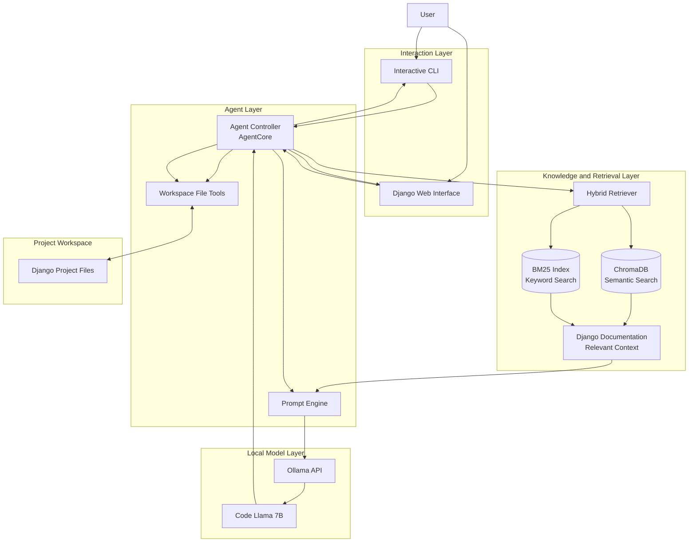
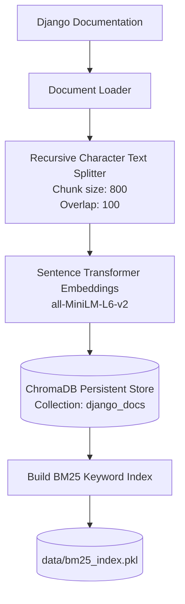
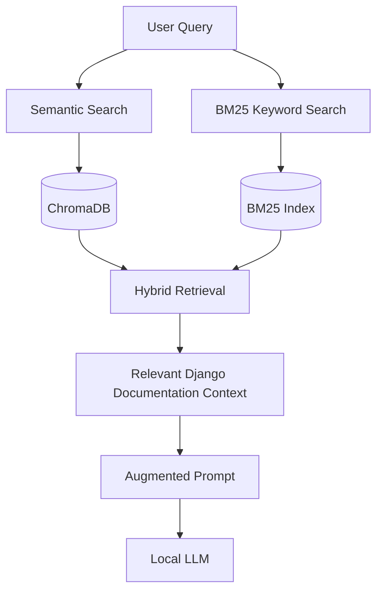
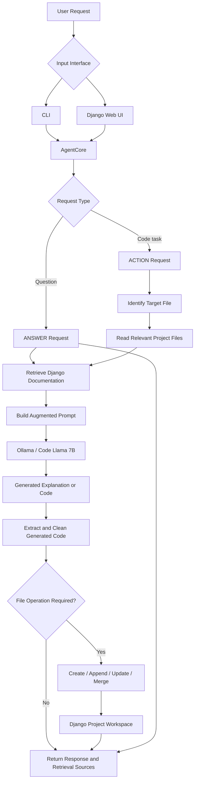
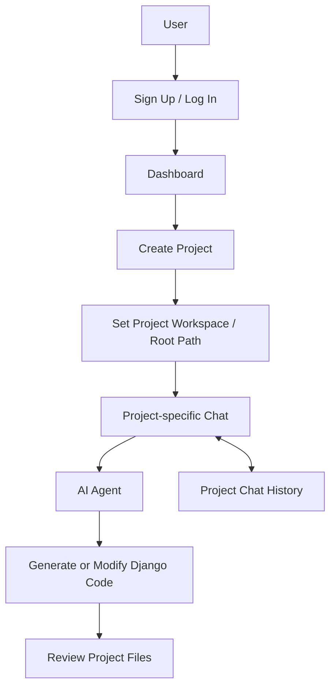
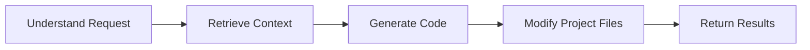

# Django AI Agent

An AI-powered Django development assistant that combines **local LLM inference, Retrieval-Augmented Generation (RAG), hybrid search, and project-aware file tools**. It helps developers understand Django documentation, answer development questions, and generate or modify code directly inside a configured project workspace.

The project supports both an interactive **CLI** and a **Django-based web interface** with authentication, project management, and project-specific chat history.

---

## Table of Contents

- [Features](#features)
- [Technology Stack](#technology-stack)
- [System Architecture](#system-architecture)
- [RAG and Hybrid Retrieval](#rag-and-hybrid-retrieval)
- [Agent Request Lifecycle](#agent-request-lifecycle)
- [AgentCore and Code Operations](#agentcore-and-code-operations)
- [Web Interface](#web-interface)
- [Repository Structure](#repository-structure)
- [Local Setup](#local-setup)
- [Initialize the RAG System](#initialize-the-rag-system)
- [Build and Verify the BM25 Index](#build-and-verify-the-bm25-index)
- [Run the CLI Agent](#run-the-cli-agent)
- [Run the Web Application](#run-the-web-application)
- [Workspace Security](#workspace-security)
- [Configuration and AI Model](#configuration-and-ai-model)
- [Development Utilities](#development-utilities)
- [Current Limitations](#current-limitations)
- [Future Improvements](#future-improvements)
- [Project Goal](#project-goal)

---

## Features

- **Django-focused AI coding assistant:** Answers Django development questions and generates Django-oriented code.
- **Multiple interfaces:** Interact through an interactive CLI or a Django web application.
- **RAG-powered documentation retrieval:** Uses Django documentation as the agent's knowledge source.
- **Hybrid retrieval:** Combines ChromaDB semantic search with BM25 keyword search.
- **Local LLM inference:** Uses Ollama to run the configured Code Llama model locally.
- **Project-aware assistance:** Reads existing project files to understand the current code context.
- **Code and file operations:** Creates files and appends or updates generated code in the configured workspace.
- **Django-aware generation rules:** Applies file-specific guidance for files such as `models.py`, `views.py`, `urls.py`, `forms.py`, and `serializers.py`.
- **Smart URL pattern merging:** Attempts to merge generated URL patterns into an existing `urlpatterns` list and avoid duplicate paths.
- **Generated-code cleanup:** Removes duplicate imports, cleans malformed output, and normalizes common formatting issues.
- **Workspace path protection:** Rejects file paths that attempt to escape the configured workspace root.
- **Web application features:** Provides signup, login/logout, project creation, project listing, and project-specific chat history.
- **RAG utilities:** Includes scripts to initialize and verify the vector database and BM25 index.

---

## Technology Stack

| Layer | Technology | Responsibility |
|---|---|---|
| Core application | Python | Agent logic and application code |
| Web framework | Django | Web interface and project environment |
| CLI | Typer, Rich | Interactive command-line interface and terminal output |
| LLM runtime | Ollama | Local model serving and generation API |
| Code-generation model | Code Llama 7B | Django code generation and explanations |
| Vector database | ChromaDB | Persistent semantic document retrieval |
| Embeddings | Sentence Transformers (`all-MiniLM-L6-v2`) | Converts documentation chunks into embeddings |
| Keyword retrieval | BM25 | Exact-term and keyword-based search |
| Text processing | LangChain Text Splitters | Splits documentation into retrieval chunks |
| Web database | SQLite | Web application database |

---

## System Architecture

The application is organized around an agent controller that coordinates project file tools, documentation retrieval, prompt construction, and local LLM generation.

### High-level architecture



### Component responsibilities

| Component | Responsibility |
|---|---|
| CLI / Django Web UI | Accepts user questions and coding requests |
| `AgentCore` | Coordinates request classification, retrieval, prompting, generation, and file operations |
| File tools | Read and modify files within the configured workspace |
| Hybrid retriever | Combines semantic and keyword retrieval |
| ChromaDB | Stores documentation embeddings for semantic search |
| BM25 | Supports keyword and exact-term matching |
| Prompt engine | Combines the request, project context, and retrieved documentation |
| Ollama / Code Llama | Generates explanations and Django-oriented code |

---

## RAG and Hybrid Retrieval

The agent uses Django documentation as its retrieval knowledge source. Documentation is loaded, split into chunks, embedded, and stored in a persistent ChromaDB collection. A BM25 index is also built from the available ChromaDB documents.

### Documentation ingestion pipeline



### Hybrid retrieval flow



### Retrieval configuration

| Setting | Configuration |
|---|---|
| Text splitter | `RecursiveCharacterTextSplitter` |
| Chunk size | 800 characters |
| Chunk overlap | 100 characters |
| Embedding model | `all-MiniLM-L6-v2` |
| Vector store | ChromaDB |
| Collection | `django_docs` |
| Similarity metric | Cosine similarity |
| BM25 index | `data/bm25_index.pkl` |

### Why hybrid search?

- **Semantic search** helps retrieve documentation based on meaning and conceptual similarity.
- **BM25 keyword search** helps locate exact Django terminology such as `ForeignKey`, `CharField`, `models.py`, `views.py`, and `urls.py`.

The retriever combines both approaches so that queries can benefit from conceptual matching as well as exact technical terms. Both indexes are loaded when the agent starts.

---

## Agent Request Lifecycle

A coding request passes through the interface, agent controller, retrieval and prompt stages, model generation, and finally the file operation or response stage.

### Request processing flow



### Processing stages

1. Receives a natural-language request through the CLI or web interface.
2. `AgentCore` identifies whether the request is an answer request or an action request.
3. For code changes, identifies the target file and reads relevant project files.
4. Retrieves relevant Django documentation through hybrid search.
5. Builds an augmented prompt using the request, project context, and retrieved documentation.
6. Sends the prompt to the local LLM through the Ollama generation API.
7. Extracts and cleans the generated explanation or code.
8. Performs the requested file operation when required.
9. Returns the response and retrieval sources.

---

## AgentCore and Code Operations

`AgentCore` is the central component responsible for coordinating the agent workflow.

Its responsibilities include:

- Detecting whether a request is an **ANSWER** or **ACTION** request.
- Identifying the target file for code modification.
- Reading relevant project files.
- Retrieving Django documentation context.
- Building the augmented prompt.
- Sending the prompt to the configured LLM.
- Extracting and cleaning generated code.
- Writing, appending, or updating project files.
- Returning the generated response and retrieval sources.

### Django-aware generation

The agent includes Django-specific rules for common project files:

```text
models.py
views.py
urls.py
forms.py
admin.py
serializers.py
signals.py
```

For example, generation for `models.py` is constrained toward Django model classes, while generation for `urls.py` is constrained toward URL patterns.

### File operations

The file tools support these operations:

```text
read
write
append
update
delete
```

Paths are resolved relative to the configured workspace root. Attempts to access files outside that root are rejected.

### Example: create a model

A user can request:

```text
Create a Student model in models.py
```

The agent can use the project context and Django documentation to generate the model and write it into the appropriate project file.

### Example: generate URL patterns

```text
Create URLs for the views in views.py and add them to urls.py
```

The agent can inspect `views.py`, identify available view functions, and generate corresponding URL patterns.

### Smart `urls.py` merging

When an existing `urls.py` already contains `urlpatterns`, the agent attempts to merge newly generated paths into the existing list instead of replacing the entire file. Duplicate paths are avoided during the merge.

### Generated-code cleanup

The output preprocessing pipeline helps handle common LLM formatting issues. It can:

- Remove unnecessary mode labels and explanatory text from code.
- Clean malformed prefixes.
- Normalize collapsed code.
- Expand collapsed Python statements.
- Merge multiple code blocks.
- Deduplicate imports.
- Fix common indentation issues.

The extraction pipeline collects code from multiple Markdown blocks and raw code sections before producing the final code block.

---

## Web Interface

Alongside the CLI, the project includes a Django web application under `web_ui_project`.

### Web application features

- User signup.
- User login and logout.
- Dashboard.
- Project creation and listing.
- Project-specific chat.
- Chat history.
- Project chat deletion.

The dashboard allows a user to create a project by providing a project name and workspace/root path. The user is then redirected to the project chat.

### Web interaction flow



---

## Repository Structure

The CLI agent's main structure is:

```text
django_cli_agent/
│
├── agent/
│   ├── agent_core.py
│   ├── cli.py
│   ├── file_tools.py
│   ├── prompt.py
│   └── workspace.py
│
├── llm/
│   └── model.py
│
├── rag/
│   ├── embeddings.py
│   ├── initialise_rag.py
│   ├── loader.py
│   ├── retriever.py
│   ├── setup.py
│   ├── splitter.py
│   └── vector_store.py
│
├── data/
│   ├── django_docs/
│   ├── vector_db/
│   └── bm25_index.pkl
│
├── agent_test_project/
│   ├── manage.py
│   ├── agent_test_project/
│   └── students/
│
├── build_bm25_index.py
├── verify_vector_db.py
├── main.py
├── config.py
└── setup.py
```

The project also contains a separate Django web application under `web_ui_project`, with `accounts`, `dashboard`, and `chat` components.

---

## Local Setup

### Prerequisites

Install or prepare:

- Python.
- Git.
- Ollama.
- The configured local LLM model.
- Django project source code that the agent will work with.

### 1. Clone the repository

```bash
git clone <your-repository-url>
cd django_cli_agent
```

### 2. Create a virtual environment

```bash
python -m venv venv
```

Activate it:

**Windows PowerShell**

```powershell
.\venv\Scripts\Activate.ps1
```

**Linux / macOS**

```bash
source venv/bin/activate
```

### 3. Install dependencies

```bash
pip install -r requirements.txt
```

If a `requirements.txt` file is not included in the repository, generate one from the development environment:

```bash
pip freeze > requirements.txt
```

---

## Initialize the RAG System

Place the Django documentation files inside:

```text
data/django_docs/
```

The persistent vector database is created under:

```text
data/vector_db/
```

The project uses a persistent ChromaDB database and creates the `django_docs` collection when building the vector store.

Run the initialization script:

```bash
python rag/initialise_rag.py
```

The project also includes a verification workflow that tests retrieval with a Django-related query and reports the retrieved context and sources.

---

## Build and Verify the BM25 Index

### 1. Build the BM25 index

Run this after initializing ChromaDB:

```bash
python build_bm25_index.py
```

The process:

1. Loads documents from ChromaDB.
2. Tokenizes the documents.
3. Builds a BM25 index.
4. Saves the index to `data/bm25_index.pkl`.
5. Runs a test query to verify the index.

After this step, the agent can use both semantic and keyword retrieval.

### 2. Verify the vector database

```bash
python verify_vector_db.py
```

The verification script checks:

- Whether the vector database exists.
- ChromaDB connectivity.
- Available collections.
- Document counts.
- Sample metadata.
- Semantic retrieval.

---

## Run the CLI Agent

Start the CLI application:

```bash
python main.py
```

The CLI starts an interactive chat session similar to:

```text
Django CLI AI Agent
Press Ctrl+C or Ctrl+D to exit

Ask:
```

The CLI continuously accepts user requests and sends them to the agent.

### Example queries

```text
Ask: How do Django models work?
```

```text
Ask: Explain the code in models.py
```

```text
Ask: Create a Student model in models.py
```

```text
Ask: Add a list_students view to views.py
```

```text
Ask: Create URLs for the views in views.py and add them to urls.py
```

---

## Run the Web Application

The web application is located under:

```text
web_ui_project/
```

Start the Django development server:

```bash
cd web_ui_project
python manage.py runserver
```

Then open the local development server in your browser.

The web application provides authentication, a dashboard, project creation, project listing, and project-specific chat functionality.

---

## Workspace Security

The agent operates relative to a configured workspace root. The workspace can be changed dynamically using:

```python
set_workspace_root("/path/to/project")
```

The file tools resolve requested paths against this workspace and reject paths that attempt to escape it.

The default CLI workspace is configured in:

```text
agent/workspace.py
```

The workspace root is configured through `WORKSPACE_ROOT`, for example:

```python
WORKSPACE_ROOT = Path(
    r"..."
).resolve()
```

Update this path to point to the Django project you want the agent to work with.

---

## Configuration and AI Model

### Ollama model

The current LLM implementation communicates with Ollama through its local generation API.

The default configured model is:

```text
codellama:7b
```

The API endpoint is:

```text
http://localhost:11434/api/generate
```

The implementation uses a default temperature of `0.1` to encourage more deterministic code generation.

### Pull and start the model

Make sure Ollama is installed. Pull the configured model:

```bash
ollama pull codellama:7b
```

Ensure Ollama is running before starting the agent.

---

## Development Utilities

| Task | Command |
|---|---|
| Initialize RAG | `python rag/initialise_rag.py` |
| Build BM25 index | `python build_bm25_index.py` |
| Verify vector database | `python verify_vector_db.py` |
| Start CLI agent | `python main.py` |
| Start web application | `cd web_ui_project` then `python manage.py runserver` |

---

## Current Limitations

The project is currently focused specifically on Django-oriented development workflows.

Areas that can be improved include:

- More robust code validation before writing generated code.
- Better automated testing of generated code.
- More sophisticated file-diff and approval workflows.
- More configurable LLM providers.
- Improved project/workspace configuration.
- More comprehensive Django documentation coverage.
- Additional Django file-type rules.
- Production deployment configuration.
- More extensive authentication and authorization controls for the web interface.

---

## Future Improvements

Potential future development includes:

- Multi-model support.
- Support for additional LLM providers.
- Automatic generated-code testing.
- Static code analysis before file modification.
- Agent execution history.
- Code change rollback.
- Git-aware modifications.
- Project-wide dependency and context analysis.
- Streaming LLM responses.
- Plugin/tool architecture.
- Docker deployment.
- Cloud deployment.
- More granular workspace permissions.

---

## Project Goal

The goal of this project is to explore how **LLMs, RAG, semantic search, keyword retrieval, and tool-based agents** can be combined to create a practical AI-assisted software development environment.

Rather than functioning only as a conversational chatbot, the agent is designed to interact with an actual Django project through this workflow:



This makes the project an exploration of **AI coding agents and agentic software development workflows**, with Django as the primary development domain.

---

Built as a project exploring:

- Artificial Intelligence.
- Large Language Models.
- Retrieval-Augmented Generation.
- Hybrid Search.
- AI Coding Agents.
- Django.
- Python.
- Software Engineering.
